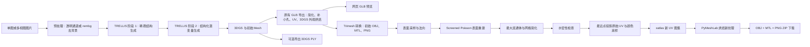

# TRELLIS 贴图 OBJ 水密后处理技术交接文档

| 项目 | 内容 |
| --- | --- |
| 文档版本 | 1.0，2026-10-12 |
| 适用代码 | `neo-jay/trellis_offline` 的 `main` 分支，后处理基线提交 `1bf4143` |
| 交接范围 | 图片生成三维结果之后的 GLB→OBJ、水密表面重建、UV 与贴图重烘焙、网页导出接入 |
| 主要源码 | [`TRELLIS/app.py`](TRELLIS/app.py)、[`TRELLIS/trellis/utils/poisson_textured_repair.py`](TRELLIS/trellis/utils/poisson_textured_repair.py)、[`start.sh`](start.sh) |
| 依赖清单 | [`TRELLIS/requirements-postprocessing.txt`](TRELLIS/requirements-postprocessing.txt) |

## 1. 范围与交付结果

本模块接收 TRELLIS 已生成的三维高斯（3DGS）和网格，沿用项目现有的 GLB 导出流程，得到带纹理的初始网格；然后生成新的水密表面，重新建立 UV 并烘焙纹理。网页最终提供包含 `sample.obj`、`sample.mtl`、`material_0.png` 的 ZIP 包。

这里的“水密”特指 **OBJ 几何边拓扑**：每条几何边恰有两个相邻三角面，且网格可被 Trimesh 判定为 `is_watertight=True`。它不等于“外形完全忠实于原图”“没有内部空腔”或“能直接作为有厚度的实体制造”。UV 接缝处可有不同纹理坐标，但不应被当作几何开放边。

当前模块不参与 TRELLIS 模型训练，也不修改稀疏结构生成、结构化潜变量生成或 3DGS 解码模型的权重。

## 2. 整体流程图

以下为交接用的**整体流程示意**。它表示数据流与模块边界，不展开 TRELLIS 神经网络内部层结构；详细模型图可在后续单独绘制。



**边界说明：**`F` 及之前主要是现有 TRELLIS 推理/导出流程；`G` 至 `O` 为本次 OBJ 水密后处理。网页中的 `Q` 目前显示的是导出时生成的原始 GLB，**不是**水密重建后的 OBJ；交付下载内容是 `O`。

## 3. 已实现功能

| 功能 | 当前实现与交付方式 |
| --- | --- |
| 单图生成 | 网页上传单张图片，生成三维高斯与网格；有有效透明通道时使用 Alpha，否则通过离线 U2Net/rembg 去背景。 |
| 多图生成 | 网页上传多个视角，使用 TRELLIS 的 `stochastic` 或 `multidiffusion` 多图模式。属于实验性原有能力。 |
| 生成过程预览 | 生成结果渲染为视频，展示 3DGS 颜色与网格法线。 |
| 3DGS 导出 | `sample.ply`，与 OBJ 后处理分支独立。 |
| OBJ 导出 | 保留原 GLB 导出链路，再转换为带纹理初始 OBJ，执行水密重建和重新烘焙。 |
| 两档重建质量 | `balanced`：采样 150,000 点，目标约 100,000 面；`high`：采样 300,000 点，目标约 200,000 面。面数是目标值，非绝对承诺。 |
| 自动拓扑检查 | 后处理脚本检查开放边数、非流形边数及 Trimesh 水密状态；未通过即报错，网页不产生成功下载包。 |
| 下载包 | ZIP 内仅含 `sample.obj`、`sample.mtl`、`material_0.png`；不含说明 TXT、临时 GLB、STL 或诊断 JSON。 |
| 网页预览与下载 | 使用 GLB 保证浏览器预览稳定；OBJ 下载按钮提供 ZIP，预览控件内的 GLB 下载图标也尝试转到 ZIP 下载。 |
| 离线启动 | `start.sh` 设置 Hugging Face、Transformers、Diffusers 和 TRELLIS 离线变量，检查已缓存权重。 |

## 4. 后处理算法详细步骤

### 4.1 初始几何与纹理生成

网页的 `extract_obj(...)` 从会话状态恢复 3DGS 和 Mesh，调用 `postprocessing_utils.to_glb(...)`。该原有函数先处理网格（包括简化和小孔填补），为网格建立 UV，再从 3DGS 多视角渲染结果烘焙初始纹理，最后将坐标从 z-up 转为 y-up。此处的“网格简化比例”含义为**待删除面数的比例**，默认 `0.95`；初始纹理尺寸默认 `1024`。

GLB 先保存在会话目录的 `sample.glb`，然后通过 Trimesh 转成 `sample_source.obj`、`sample.mtl` 和 `material_0.png`。OBJ 后处理在已旋转的坐标系内进行，不再做坐标轴转换。

### 4.2 有向点云采样与 Poisson 重建

脚本移除未引用顶点、退化面，校正源网格法向；通过 `trimesh.sample.sample_surface` 在源三角面采样点，并取对应面的法向，形成有向点云。NumPy 采样种子固定为 `1234`。

使用 Open3D 的 `create_from_point_cloud_poisson` 重建表面，当前固定参数为 `depth=9`、`scale=1.05`、`linear_fit=False`、`n_threads=-1`。`depth` 控制重建八叉树细节上限；`scale` 控制重建包围范围。该步骤会改变原始几何与拓扑，主要目标是得到平滑、闭合的表面，并减弱此前体素化方案的“像素块”外观。

Poisson 可能产生多个连通体；脚本只保留**面数最多的一个连通体**。若面数超过质量档位目标，则调用 Open3D 的二次误差网格简化。最后再次清理未引用顶点并校正法向。

### 4.3 水密性门禁

对几何边的两个顶点索引排序后统计出现次数：出现 1 次的是开放边，出现超过 2 次的是非流形边。结果需同时满足：

```text
boundary_edges == 0
nonmanifold_edges == 0
trimesh.is_watertight == True
```

任何条件失败，脚本抛出异常并返回非零退出码；网页显示“OBJ 水密重建失败”。这是对处理结果的运行时检查，不是对所有可能输入都能修复成功的保证。

### 4.4 原颜色回投与 UV 重建

原始 OBJ 的颜色来自旧 UV 及 `material_0.png`。对**新网格每个顶点**，Open3D RaycastingScene 查找原网格上的最近点和三角面。脚本用该点在三角形内的重心坐标插值旧 UV，再从原贴图进行双线性采样，得到新网格顶点颜色。

随后 xatlas 为新网格生成新的 UV 图集；PyMeshLab 将新网格顶点颜色烘焙为新的 `material_0.png`，导出带 UV 的 `sample.obj` 与 `sample.mtl`。当前实现是“最近点投影 → 顶点颜色 → 新纹理”两级近似，因此细薄结构、密集文字或高频纹理可能变模糊，遮挡处的颜色也可能受最近表面影响。输出并非逐像素从原图直接重投影。

### 4.5 诊断与打包

独立脚本会在输出目录写出：

- `sample.obj`、`sample.mtl`、`material_0.png`：正式交付文件；
- `sample.stl`：无贴图的几何检查文件；
- `repair_report.json`：输入/输出拓扑及贴图投影统计。

网页只把前三项压缩为 `sample_obj_package.zip`。`projection_mean_distance` 和 `projection_p95_distance` 是新顶点到原始网格最近点的**模型坐标距离**，不是毫米、像素或“准确率”。

## 5. 网页外部接口

### 5.1 访问方式与输入

服务由 Gradio 启动，默认监听 `0.0.0.0:7860`。浏览器通过平台端口转发或 `http://<服务器地址>:7860` 访问。当前 `demo.launch(..., show_api=False, share=False)`；项目**没有定义稳定的公开 REST API**，甲方系统集成应优先使用命令行后处理接口，或另行开发受版本控制的 HTTP API，不应把 Gradio 内部请求路径当作正式协议。

| 网页输入 | 类型/范围 | 默认值 | 作用 |
| --- | --- | --- | --- |
| 输入图片 | 单张 RGBA/PNG，或多张图片 | 无 | TRELLIS 推理输入；多图需为同一物体不同视角。 |
| 随机种子 | 整数 `0..2^31-1` | 0，默认勾选随机化 | 控制推理采样。 |
| 阶段 1 引导强度 | 浮点 `0..10` | 7.5 | 稀疏结构生成的 CFG 强度。 |
| 阶段 1 采样步数 | 整数 `1..50` | 12 | 稀疏结构采样次数。 |
| 阶段 2 引导强度 | 浮点 `0..10` | 3.0 | 结构化潜变量生成的 CFG 强度。 |
| 阶段 2 采样步数 | 整数 `1..50` | 12 | 结构化潜变量采样次数。 |
| 多视图算法 | `stochastic` / `multidiffusion` | `stochastic` | 仅多图模式使用。 |
| 网格简化比例 | 浮点 `0.90..0.98` | 0.95 | 初始 GLB 导出阶段的面数删除比例。 |
| 纹理尺寸 | 512、1024、1536、2048 | 1024 | 初始纹理及最终烘焙纹理边长，单位像素。 |
| 水密表面重建质量 | `balanced` / `high` | `balanced` | 控制采样点数与目标面数。 |

网页生成顺序为：上传与预处理 → 点击“生成3D模型” → 生成完成后点击“导出OBJ模型” → 下载 `sample_obj_package.zip`。OBJ 导出依赖当前会话已生成的 3DGS 和 Mesh；不能直接在网页上传任意 OBJ 来修复。

### 5.2 网页输出与会话生命周期

| 输出 | 实际内容 | 说明 |
| --- | --- | --- |
| “生成的3D模型”视频 | `sample.mp4` | 3DGS 颜色与网格法线渲染。 |
| “导出的OBJ/高斯模型”预览 | OBJ 导出时为 `sample.glb` | 用于浏览器展示；不是最终修复网格。 |
| “下载OBJ模型包” | `sample_obj_package.zip` | 正式交付结果。 |
| “下载高斯模型” | `sample.ply` | 3DGS 导出，与水密 OBJ 处理独立。 |

文件写在 `TRELLIS/tmp/<Gradio session_hash>/`。页面卸载时会尝试删除整个会话目录；Gradio 同时配置了缓存清理。需要长期保存的文件应及时下载或复制到持久化目录，不应依赖该临时路径。

## 6. 命令行外部接口

### 6.1 后处理命令与输入契约

```bash
export TRELLIS_POSTPROCESS_PYTHON=/opt/trellis-postprocess/bin/python
mkdir -p /data/result/watertight
"$TRELLIS_POSTPROCESS_PYTHON" /root/TRELLIS/trellis/utils/poisson_textured_repair.py \
  /data/input/sample_source.obj \
  /data/result/watertight \
  --texture-size 1024 \
  --quality balanced
```

位置参数 1 为**带 UV 的三角面 OBJ**。其父目录必须存在名为 `material_0.png` 的原始纹理；OBJ/MTL 中的纹理引用也应可正常解析。位置参数 2 为输出目录，不存在时脚本会创建。建议输入与输出分开存放。脚本只处理一个 OBJ，不负责批量遍历、GLB→OBJ 转换、图片推理或自动识别任意纹理文件名。

| 参数 | 必选 | 类型/取值 | 默认值 |
| --- | --- | --- | --- |
| `source_obj` | 是 | OBJ 文件路径 | 无 |
| `output` | 是 | 输出目录路径 | 无 |
| `--texture-size` | 否 | 正整数，单位像素 | 1024 |
| `--quality` | 否 | `balanced` / `high` | `balanced` |

成功退出码为 `0`；失败为非 `0`。成功时会向标准输出打印诊断报告，但依赖库也可能打印日志，因此**标准输出不是严格的纯 JSON API**；机器读取请使用输出目录中的 `repair_report.json`。

### 6.2 标准输出文件与报告字段

```text
/data/result/watertight/
├── sample.obj          # 新网格、面、法线与 UV
├── sample.mtl          # OBJ 材质定义，引用 material_0.png
├── material_0.png      # 新烘焙纹理
├── sample.stl          # 无贴图几何检查文件，不在网页 ZIP 内
└── repair_report.json  # 诊断报告，不在网页 ZIP 内
```

`repair_report.json` 的字段契约：

| 字段 | 含义 |
| --- | --- |
| `method` | 当前固定为 `screened_poisson_xatlas_rebake`。 |
| `quality`、`point_count` | 质量档位与采样点数。 |
| `source`、`result` | 输入与重建网格的拓扑统计。 |
| `vertices`、`faces` | 顶点数与三角面数。 |
| `boundary_edges` | 仅被一个三角面引用的几何边数量。 |
| `nonmanifold_edges` | 被超过两个三角面引用的几何边数量。 |
| `watertight` | Trimesh 的水密性判定。 |
| `components` | 连通组件数量。 |
| `wedge_uv_count` | 输出三角面角点 UV 数量，通常为 `3 × faces`。 |
| `projection_mean_distance`、`projection_p95_distance` | 新顶点到原网格最近点的平均距离及 95 分位距离，单位为模型坐标。 |

## 7. 内部接口与调用关系

| 接口 | 输入 | 返回/副作用 | 调用方 |
| --- | --- | --- | --- |
| `app.py:image_to_3d(...)` | 图片、推理采样参数、Gradio 请求 | `(state, sample.mp4 路径)`；`state` 持有 3DGS 与 Mesh 数组。 | 网页“生成3D模型”。 |
| `app.py:extract_obj(state, mesh_simplify, texture_size, repair_quality, req)` | 当前会话状态、简化比例、纹理尺寸、质量档位、Gradio 请求 | `(sample.glb 路径, sample_obj_package.zip 路径)`；启动独立后处理进程。 | 网页“导出OBJ模型”。 |
| `postprocessing_utils.to_glb(gs, mesh, ...)` | 3DGS 与 Mesh | 带纹理 Trimesh/GLB；包括原有网格处理、UV 和 3DGS 外观烘焙。 | `extract_obj`。 |
| `poisson_textured_repair.py:reconstruct(source, point_count, target_faces)` | Trimesh、采样点数、面数目标 | 通过拓扑检查的新 Trimesh；失败抛异常。 | 后处理 CLI。 |
| `poisson_textured_repair.py:bake(source, target, texture_path, output, texture_size)` | 原始与目标网格、原纹理、输出目录、尺寸 | 输出 OBJ/MTL/PNG，返回投影统计。 | 后处理 CLI。 |
| `poisson_textured_repair.py:topology(mesh)` | Trimesh | 顶点、面、开放边、非流形边、水密和连通体统计字典。 | 后处理 CLI。 |

网页通过 `subprocess.run(..., timeout=900, check=True, capture_output=True)` 调用后处理脚本。独立进程使用 `TRELLIS_POSTPROCESS_PYTHON` 指定的解释器；未设置时退回网页进程的 `sys.executable`。脚本路径按 `app.py` 所在目录相对拼接，因此源码本身不再绑定 `/root/TRELLIS`。子进程继承环境变量；如设置 `TRELLIS_PYMESHLAB_PYTHONPATH`，会将其前置到子进程的 `PYTHONPATH`。超时上限为 **900 秒**。

`state` 是网页内部会话对象，包含 NumPy 数组和模型参数；它不是持久化交换格式，也没有独立文件协议。第三方集成建议从命令行 OBJ 接口或下载文件边界开始。

`pack_state()` 当前把高斯的初始化参数与 `_xyz`、`_features_dc`、`_scaling`、`_rotation`、`_opacity` 数组放入 `state['gaussian']`，把顶点和面索引数组放入 `state['mesh']['vertices']`、`state['mesh']['faces']`。`unpack_state()` 会把这些数组重新放到 CUDA 设备上。字段是**内部实现结构**，没有序列化版本号；甲方不应直接依赖它做跨服务、跨版本传输。

## 8. 环境、安装与运行

### 8.1 环境分层

| 层 | 当前远程示例 | 作用 |
| --- | --- | --- |
| 主推理环境 | `/root/miniconda3/bin/python`，NVIDIA CUDA GPU | TRELLIS、PyTorch、Gradio、3DGS 渲染和初始 GLB 贴图生成。 |
| 后处理环境 | `/root/autodl-tmp/conda-envs/gggs/bin/python`，Python 3.12 | Open3D、PyMeshLab、xatlas 等；独立于主推理环境。 |
| 额外 PyMeshLab 路径 | `/root/autodl-tmp/tools/pymeshlab_py` | 当前远程以 `PYTHONPATH` 加载 PyMeshLab 和对应 NumPy。标准 pip 安装可不使用。 |
| 本地权重缓存 | `/root/.cache/huggingface/hub`、`/root/.cache/torch`、`/root/.u2net` | 离线推理所需模型权重；详见 [`OFFLINE_USAGE.md`](OFFLINE_USAGE.md)。 |

后处理直接依赖的已验证版本见 [`requirements-postprocessing.txt`](TRELLIS/requirements-postprocessing.txt)：Python 3.12、NumPy 2.5.4、Open3D 0.20.0、Pillow 12.3.0、PyMeshLab 2025.7.post1、Trimesh 5.1.0、xatlas 0.0.11。后处理脚本本身是 CPU 侧几何处理；完整网页推理、原始 GLB 生成仍需要可用的 NVIDIA CUDA GPU。

**平台适配边界：**当前版本仅在 NVIDIA CUDA 远程环境完成端到端验证。`start.sh` 会显式检查 `torch.cuda.is_available()`，TRELLIS 还包含 CUDA 相关扩展；只有昇腾/CANN、没有 NVIDIA CUDA 的目标机不能直接按本页命令运行完整图片生成流程。后处理的 CPU 算法可单独迁移，但仍须为目标 CPU 架构准备匹配的 Open3D、PyMeshLab、xatlas 等二进制包，并重新验证。该文档不表示已完成昇腾推理适配。

### 8.2 联网准备安装包，离线目标机安装

在**与目标机相同 Linux 架构、相同 Python 3.12 ABI** 的联网构建机准备依赖包，并将 Python 安装包、所有 wheel、系统包及已有 TRELLIS 权重一并交付：

```bash
python3.12 -m pip download --only-binary=:all: \
  -r TRELLIS/requirements-postprocessing.txt -d wheelhouse
```

若目标架构缺少现成 wheel，以上命令会失败；需先在兼容环境构建所需 wheel，再做离线安装和验收。

在目标机上：

```bash
python3.12 -m venv /opt/trellis-postprocess
/opt/trellis-postprocess/bin/pip install --no-index --find-links /path/to/wheelhouse \
  -r /root/TRELLIS/requirements-postprocessing.txt
/opt/trellis-postprocess/bin/python -c 'import numpy, open3d, PIL, pymeshlab, trimesh, xatlas; print("postprocess dependencies OK")'
```

如导入 Open3D/PyMeshLab 时提示缺少 Linux 动态库，需按系统发行版离线安装对应的 OpenGL/X11 运行库；Debian/Ubuntu 示例见 [`POSTPROCESSING.md`](POSTPROCESSING.md)。发行版不同，包名可能不同。仓库中的 `requirements-postprocessing.txt` 仅列直接 Python 依赖，`pip download` 会一并解析传递依赖；仓库不附带 wheel 或系统安装包。

### 8.3 当前 AutoDL 远程启动网页

当前仓库的 `start.sh` 以 `/root/TRELLIS`、`/root/miniconda3` 和 `/root` 下模型缓存为部署约定。运行前确认最新代码位于这些目录、权重已经恢复、后处理解释器可用：

```bash
export TRELLIS_POSTPROCESS_PYTHON=/root/autodl-tmp/conda-envs/gggs/bin/python
export TRELLIS_PYMESHLAB_PYTHONPATH=/root/autodl-tmp/tools/pymeshlab_py
cd /root
./start.sh
```

当前 `start.sh` 在这两个变量未设置时会尝试使用已知的 `/opt/trellis-postprocess/bin/python` 或 AutoDL 路径。换机器部署时，应显式设置变量，并按实际目录调整 `start.sh` 的主程序及权重路径检查；仅复制仓库源码不会自动获得模型权重和后处理安装包。

指定端口及后台运行示例：

```bash
TRELLIS_SERVER_NAME=0.0.0.0 TRELLIS_SERVER_PORT=7860 /root/start.sh
nohup env TRELLIS_SERVER_NAME=0.0.0.0 TRELLIS_SERVER_PORT=7860 \
  TRELLIS_POSTPROCESS_PYTHON=/root/autodl-tmp/conda-envs/gggs/bin/python \
  TRELLIS_PYMESHLAB_PYTHONPATH=/root/autodl-tmp/tools/pymeshlab_py \
  /root/start.sh > /root/trellis_start.log 2>&1 &
```

```bash
tail -f /root/trellis_start.log
```

`start.sh` 会关闭常见代理变量并设置 `HF_HUB_OFFLINE=1`、`TRANSFORMERS_OFFLINE=1`、`DIFFUSERS_OFFLINE=1`、`TRELLIS_OFFLINE=1`，检查模型缓存和 CUDA；后处理算法本身不下载模型。离线验收应在禁网环境中完成一次完整图片生成及 OBJ 导出，单独启动网页不等于端到端离线验证。

### 8.4 离线权重与代码包的版本关系

仓库源码、GitHub Release 中的权重资产、`trellis_offline_source.tar.gz` 可能分别在不同时间生成。若甲方使用旧版源码压缩包恢复，即使仓库 `main` 已更新，恢复后的 `/root/TRELLIS` 也可能**不包含**本后处理代码。交付时需使用包含本文件所述提交的源码，或重建源码压缩包并记录 SHA256；权重资产可按既有离线流程恢复。具体权重目录见 [`OFFLINE_USAGE.md`](OFFLINE_USAGE.md)。

## 9. 验证与验收建议

### 9.1 文件与拓扑验收

独立命令行验收：

```bash
/opt/trellis-postprocess/bin/python /root/TRELLIS/trellis/utils/poisson_textured_repair.py \
  /data/input/sample_source.obj /data/result/watertight \
  --texture-size 1024 --quality balanced
```

确认 `repair_report.json` 中 `result.boundary_edges=0`、`result.nonmanifold_edges=0`、`result.watertight=true`，并验证 OBJ 引用了 MTL，MTL 引用了 PNG；在 3D 软件中检查纹理显示、方向、尺度和薄结构。若甲方以 STL 检查开放边，可用同时生成的 `sample.stl`，但 STL 不保留贴图。

建议再用独立读取器复核正式交付 OBJ，而不只相信脚本自身报告：

```bash
/opt/trellis-postprocess/bin/python -c '
import numpy as np, trimesh
m = trimesh.load_mesh("/data/result/watertight/sample.obj", force="mesh", process=False)
_, counts = np.unique(np.sort(m.edges, axis=1), axis=0, return_counts=True)
print("boundary", int((counts == 1).sum()), "nonmanifold", int((counts > 2).sum()), "watertight", m.is_watertight)
'
```

此前一次回归样例的输入为 6,503 顶点、8,420 面、4,134 条开放边；处理后为 49,974 顶点、100,000 面、**0 条开放边、0 条非流形边、1 个连通体**，`is_watertight=True`，并生成 OBJ/MTL/PNG。该样例证明这一组输入成功，不构成对所有图片的普遍保证。

### 9.2 失败定位

| 现象 | 优先检查 |
| --- | --- |
| 网页启动前报模型缓存缺失 | `start.sh` 的 Hugging Face、DINOv2、U2Net 路径及资产恢复步骤。 |
| 网页启动前报无 GPU | 容器 GPU 透传、CUDA 驱动及主推理 Python 的 `torch.cuda.is_available()`。 |
| OBJ 导出时报 `ModuleNotFoundError` | `TRELLIS_POSTPROCESS_PYTHON` 指向的解释器及 `TRELLIS_PYMESHLAB_PYTHONPATH`。 |
| 报源 OBJ 无 UV 或找不到 PNG | 输入 OBJ/MTL/`material_0.png` 是否成套、同目录且可读取。 |
| 报 Poisson 非流形或不水密 | 检查源网格破损、法向、大量离散碎片；保留输入和 `repair_report.json`/错误日志分析。 |
| 网页超过 15 分钟失败 | 改为 `balanced`，检查 CPU/内存与输入面数；当前网页超时固定为 900 秒。 |
| 模型封闭但形状或贴图不理想 | 对比原始 GLB 与最终 OBJ，检查 Poisson 平滑、最大连通体舍弃、最近点投影与贴图重烘焙误差。 |
| 网页预览与下载的形状不同 | 当前预览原始 GLB，下载为水密 OBJ；属于现有实现边界。 |

## 10. 已知限制与后续接口扩展点

1. **拓扑可能改变。**Poisson 会填平小孔、跨接近邻表面或形成内部封闭结构；原始网格的部件边界及孔洞不保证保留。
2. **只保留一个连通体。**分离的小零件可能被丢弃。多零件交付需调整 `reconstruct()` 的连通体策略与逐部件导出规则。
3. **贴图为近似重烘焙。**现用顶点颜色作为中介；要保留高频纹理，可改为逐纹素从新网格投影原网格并设置遮挡判别。
4. **预览与交付文件不同。**网页预览是原始 GLB。若必须预览修复结果，应在后处理中额外生成修复版 GLB，并将其传给 `LitModel3D`。
5. **输入命名固定。**命令行脚本读取源 OBJ 同目录的 `material_0.png`；如需通用 OBJ 修复，需新增显式 `--texture` 参数与多材质支持。
6. **部署路径有约定。**`app.py` 已通过变量配置后处理解释器，`start.sh` 的主推理、权重路径仍按 `/root` 布局编写。不同环境应调整脚本或制作镜像。
7. **无正式网络 API。**现有外部可依赖接口是网页交互、CLI 参数以及 OBJ/MTL/PNG/JSON 文件；若要服务化，应单独定义鉴权、任务队列、状态查询、错误码和文件生命周期。
8. **无尺寸标定。**模型坐标没有真实世界单位；水密检查不提供真实长度、体积精度或制造公差保证。

## 11. 交接文件清单

| 文件 | 用途 |
| --- | --- |
| [`TRELLIS/app.py`](TRELLIS/app.py) | 网页输入、推理状态、OBJ 导出与 ZIP 打包接入。 |
| [`TRELLIS/trellis/utils/poisson_textured_repair.py`](TRELLIS/trellis/utils/poisson_textured_repair.py) | 独立后处理 CLI、拓扑检查、UV 与纹理重烘焙。 |
| [`TRELLIS/requirements-postprocessing.txt`](TRELLIS/requirements-postprocessing.txt) | 后处理直接 Python 依赖版本。 |
| [`start.sh`](start.sh) | 当前 `/root` 布局下的离线网页启动入口。 |
| [`POSTPROCESSING.md`](POSTPROCESSING.md) | 简明安装与使用说明。 |
| 本文档 | 算法、功能、接口、运行与验收规范。 |

交付给甲方时还应另附与其操作系统、CPU 架构、GPU 驱动匹配的主推理环境、后处理 wheelhouse、系统包、模型权重及相应校验值。上述二进制资产未包含在本技术文档或本次代码变更中。
